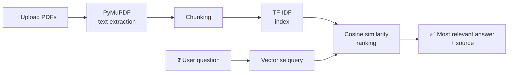

<div align="center">

# 📚 Smart Study Companion (SSC)

**A fully local, privacy-first study assistant that answers questions straight from your own lecture PDFs.**


[Why SSC](#-why-ssc) • [Features](#-key-features) • [How It Works](#-how-it-works) • [Tech Stack](#%EF%B8%8F-tech-stack) • [Setup](#-installation--setup) • [Privacy](#-privacy--security)

</div>

---

## 🎯 The Problem

LLM platforms are powerful, but lecture notes are often **too large, upload-restricted, or too privacy-sensitive** to hand over to a cloud service.

**SSC removes that limit.** Your PDFs stay on your machine, and you still get fast, relevant answers from them.

> Built by a university student, **for university students**.

---

## 🚀 Why SSC?

| | |
|---|---|
| 🔒 **100% local** | No data ever leaves your machine |
| 📄 **Built for real lecture PDFs** | Handles large, detailed, multi-file modules |
| 🚫 **No AI APIs** | No subscriptions, no upload caps, no rate limits |
| 🧠 **Context-aware answers** | Responses come from *your* notes, with source attribution |
| 🗂️ **Session-based** | Each chat session keeps its own PDFs and history |

---

## ✨ Key Features

- 📥 Upload **multiple PDFs** per study session
- 💬 Ask **natural-language questions** about lecture content
- 🎯 Get **concise, relevant answers** with the source they came from
- 🗂️ Keep **separate sessions** for different modules
- 🕓 **Chat history** preserved per session (while the server runs)
- 🌙 Modern **dark, animated UI** with smooth UX

---

## 🧠 How It Works



1. PDFs are uploaded and processed **locally** with PyMuPDF
2. Text is split into chunks and indexed with **TF-IDF**
3. Your question is vectorised and scored against every chunk with **cosine similarity**
4. The best-matching section is returned as a concise answer
5. Each session keeps its own PDFs, index and history

---

## 🛠️ Tech Stack

| Layer | Tools |
|---|---|
| **Backend** | Python, Flask (REST API & session handling) |
| **Document processing** | PyMuPDF (`fitz`) for local text extraction |
| **Search & ranking** | TF-IDF vectorisation (scikit-learn), cosine similarity |
| **Frontend** | HTML, CSS (custom dark UI & animations), vanilla JavaScript |
| **Security** | Fully offline · no external APIs · no cloud services · no data sharing |

---

## 📦 Installation & Setup

### Prerequisites

- Python **3.9+**
- `pip`

### 1. Clone the repository

```bash
git clone https://github.com/Code-tech77/<repo-name>.git
cd <repo-name>
```

### 2. Install dependencies

```bash
pip install flask pymupdf scikit-learn
```

### 3. Run the app

```bash
python app.py
```

Then open **http://127.0.0.1:5000** in your browser.

---

## 🎓 Use Cases

- 📖 University lecture revision
- 📝 Exam preparation
- 📚 Large module handouts
- 🔐 Privacy-sensitive academic notes
- ✈️ Offline studying

---

## 🔐 Privacy & Security

SSC is **privacy-first by design**:

- ✅ No internet connection required after setup
- ✅ No third-party APIs
- ✅ No telemetry or tracking
- ✅ All data stays on your local machine

---

## ⭐ Contributing

Contributions, feedback and ideas are welcome!
Fork the repository, open an issue, or submit a pull request.

---

## 👨‍💻 Author

<div align="center">

**Mohammed Zuoriki**
Cybersecurity Student · Aspiring Cloud Security Architect

[](https://www.linkedin.com/in/mohammed-zuoriki-856133250/)
[](https://github.com/Code-tech77)

*If SSC helped you revise, consider giving it a ⭐*

</div>
